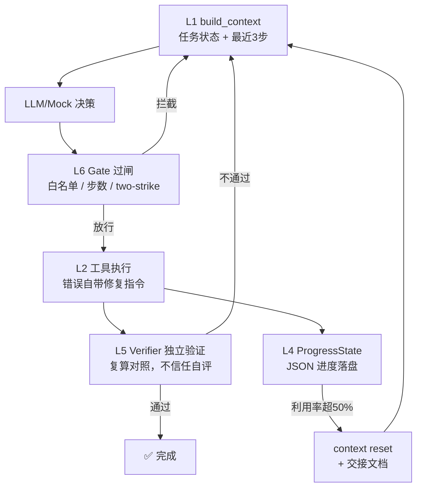

# 深入专题 · Agent Loop 工程实战（用 Harness 六层框架跑起来）

> [Harness工程实战](./Harness工程实战.md) 讲的是"**应该建什么**"——六层检查框架、成熟度阶梯、一线案例；
> 本文讲"**怎么建**"——用约 250 行可离线运行的 Python，把六层框架落成一个标准的 **Agent Loop**（业界通用叫法，Anthropic/OpenAI 均用 "agent loop / agentic loop" 指代"模型决策 → 工具执行 → 结果观察"的核心循环）。
>
> 两个概念别混：**Agent Loop 是循环本身，Harness 是让循环跑得稳的工程层**（模型之外的一切）。Loop 回答"怎么转"，Harness 回答"怎么不翻车"。
>
> **配套代码**：[project9_agent_loop.py](../10-AI应用实战/code/project9_agent_loop.py)（无模型依赖，`python project9_agent_loop.py` 直接跑）

## 1. 这个工程解决什么

| Agent Loop 三大痛点 | 对应 demo | 一句话 |
|---------------------|-----------|--------|
| 怎么形成"做→查→修"的闭环 | demo1 | 幻觉工具被拦截 → 修正 → 执行 → **独立验证**才允许结束 |
| 怎么防死循环、防傻转 | demo2 | 同样的失败调用连续 2 次 → **two-strike 升级人工** |
| 上下文越滚越长怎么办 | demo3 | 超阈值 → context reset + **结构化交接文档**，reset 零信息损失 |

**类比**：这不是又一个 ReAct 教程（那是模型怎么"出招"），而是给 Agent 配一套**拳台规则 + 裁判 + 计分牌**——模型只管出招，Harness 主持全局。

## 2. 架构总览



运行后产出两个文件，对应 Harness 的 L4 与 L5：

- `agent_loop_state.json` —— 进度文件（断点续跑的依据）
- `agent_loop_trace.log` —— JSONL 观测日志（每个决策留痕，grep 友好）

## 3. 六层框架 → 代码映射

对照 [Harness工程实战 §2 六层检查框架](./Harness工程实战.md)：

| 层 | 代码位置 | 关键设计 |
|----|----------|----------|
| L1 信息边界 | `build_context()` | 喂"**任务状态**"而非堆全量历史——上下文可以 reset，状态不能丢 |
| L2 工具系统 | `TOOLS` 注册表 | 错误信息自带修复指令（"错误即上下文"，OpenAI 实践） |
| L3 执行编排 | `AgentLoop.run()` | 决策 → 过闸 → 执行 → 验证 的**四拍循环** |
| L4 记忆状态 | `ProgressState` | JSON 进度文件落盘；`handoff()` 生成结构化交接文档 |
| L5 评估观测 | `verify_*` + `trace()` | **独立复算**对照答案，不用 AI 眼睛查 AI 作业 |
| L6 约束恢复 | `Gate` + two-strike | 白名单拦截、重复失败检测、最大步数、升级人工 |

起步建议同样适用：这套代码里 **L1 + L6 是骨架**（先跑通防呆），L4/L5 是血肉（可观测、可恢复），L2 按需扩工具。

## 4. 三个场景逐段拆解（实际运行输出）

### demo1 · 完整闭环：验证结果说了算

```
[round 1] 决策: {"tool": "search_web", ...}          ← 模型幻觉出一个不存在的工具
  🚫 [L6 拦截] 工具 search_web 不存在，可用工具：[...]。修复指令：从白名单中重选
[round 2] 决策: calculator(238*47) -> 11186           ← 拿到修复指令后自我修正
[round 3] 决策: calculator(11186/3) -> 3728.6667
[round 4] 决策: final "每部门 3728.67 元"
  ✅ [L5 验证通过] 独立复算结果 3728.67 元            ← Harness 自己算一遍才放行
```

三个要点：

1. **拦截反馈是"可执行的操作"**（说清缺什么、给修复指令），而不是一句"参数错误"——这是失败反馈能驱动迭代的前提
2. **结束权在验证器手里**：模型说"我做完了"不算数，`verify_settlement()` 独立复算 `238*47/3` 对照通过才置 `status=done`
3. **断点续跑**：任务完成状态落盘后，同任务再跑直接跳过——崩溃恢复的基础

### demo2 · two-strike：傻转 2 次就喊人

```
[round 1] calculator(500/0) -> 错误：除数为 0。修复指令：先核对分母数据来源...
[round 2] calculator(500/0)                          ← 同样的失败再来一次
  🚨 [L6 升级人工] 连续 2 次相同失败调用，停止重试，升级人工
```

这是 Stripe "two-strike 后升级人工"的最小实现：**失败 1 次给机会（错误即上下文），失败 2 次说明模型没在读反馈**——继续自动重试只是烧 token，正确动作是升级人工。核心判定是"**相同签名**的失败调用"（工具名+参数），不是模糊的"失败了"。

### demo3 · 上下文交接：reset 零信息损失

```
[round 2] ctx利用率 33% | get_weather(上海)
  📈 上下文利用率 67% > 50% → context reset
  📄 交接文档：{"目标": "查 5 个城市天气并汇总最热城市",
              "已完成(已验证)": ["北京=>晴 26°C", "上海=>多云 29°C"],
              "失败与原因": [], "下一步": "从未完成步骤继续"}
[round 3] ctx利用率 0% | get_weather(深圳)            ← 带着交接文档继续，不丢进度
```

为什么 reset 不丢信息？因为 **L1 用状态驱动而非历史驱动**：所有已完成步骤都在 `ProgressState` 里落了盘，历史区清空后，下一轮 `build_context()` 照样能拼出"目标 + 已验证进度 + 最近几步"。这正是 [上下文工程详解](./上下文工程详解.md) 里"结构化交接文档"的可运行版本——**没有 L1 的状态化设计，reset 就等于失忆**。

> 演示用历史条数模拟 token 预算（阈值 50%）；生产环境应按 tokenizer 真实计数，并参考 Smart/Dumb Zone 自测阈值。

## 5. 关键设计决策复盘

| 决策 | 为什么 | 反模式对照 |
|------|--------|-----------|
| 状态驱动上下文 | reset/续跑零损失；LLM 看到的永远是"现在到哪了" | 把 50 轮对话原文塞进 prompt |
| 错误信息带修复指令 | 失败反馈是可执行操作，模型一次修正 | 报错只说"invalid argument" |
| 验证器独立复算 | 用 AI 写的测试验证 AI 代码 = 同一双眼睛查作业 | 让模型自己回答"你做对了吗" |
| two-strike 升级人工 | 重复失败说明反馈回路失效，止损优先 | max_steps 拉到 100 硬扛 |
| 进度文件落盘 | 长任务可崩溃恢复、可人工干预后继续 | 状态只活在内存里 |

## 6. 从 Mock 到真实 LLM（改造路径）

`MockLLM` 只是个剧本播放器，真实接入只需替换 `decide()`：

```python
class RealLLM:
    """把 MockLLM 换成真实模型：system prompt 只给结构化状态，不给历史堆栈"""
    def __init__(self, client, model):
        self.client, self.model = client, model

    def decide(self, ctx) -> dict:
        resp = self.client.chat.completions.create(
            model=self.model, temperature=0,
            messages=[
                {"role": "system", "content":
                    "你是 Agent Loop 中的决策器。根据任务状态输出一个 JSON 动作："
                    '{"tool": "工具名", "args": {...}} 或 {"tool": "final", "answer": "..."}。'
                    "只能使用给定工具白名单。"},
                {"role": "user", "content": json.dumps(ctx, ensure_ascii=False)},
            ],
            response_format={"type": "json_object"},
        )
        return json.loads(resp.choices[0].message.content)
```

注意：**循环、过闸、验证、状态落盘全都不用改**——这正是 Harness 工程的意义：模型可替换，Harness 是稳定层。完整改造作业见代码末尾注释（token 真实计数、压缩替代清空、AI 自评 vs 独立验证对比实验）。

## 7. 对照成熟度阶梯：这个工程在哪一级

按 [Harness工程实战 §5 成熟度阶梯](./Harness工程实战.md)：

- 本工程 ≈ **L2（反馈回路）**：有独立验证、进度追踪、失败反馈回路
- 距 L3 还差：分层上下文（渐进披露）、多 Agent 分工、长期记忆
- 距 L4 还差：无人值守并行、自动清理、自修复

一句话：**先把这个 L2 骨架跑稳，再谈加层**——和六层框架的起步建议（先 L1+L6）完全一致。

## 8. 学完自测检查点

1. 为什么"结束权在验证器手里"？把 `verify_settlement` 删掉直接 return 会发生什么
2. two-strike 为什么按"工具名+参数签名"判定，而不是"连续失败 2 次"就升级？
3. demo3 里 reset 之后模型为什么"知道"该查深圳？（提示：两种原因，脚本与真实 LLM 各是什么）
4. 把 `ProgressState` 去掉、全靠 history 传状态，reset 会出什么问题？
5. 本工程对应成熟度阶梯哪一级？要升到 L3 最先该补哪两项？
6. 用自己的话说清 Agent Loop 与 Harness 的关系（谁转圈、谁定规则）

## 9. 延伸阅读

- [Harness工程实战](./Harness工程实战.md) —— 本文的理论底座：六层框架、成熟度阶梯、OpenAI/Stripe 案例
- [上下文工程详解](./上下文工程详解.md) —— demo3 交接机制的原理：Smart/Dumb Zone、压缩与渐进披露
- [Agent设计模式详解](./Agent设计模式详解.md) —— Loop 模式在 14 种设计模式中的位置，ReAct 与 Agent Loop 的分工
- [Agent工程体系总览](./Agent工程体系总览.md) —— Prompt → Context → Harness → Loop 四代范式，本文属于第四代
- [Agent权限体系与动态授权](./Agent权限体系与动态授权.md) —— L6 的进阶版：PDP/PEP 过闸、JIT 授权（配套 `project8_dynamic_permissions.py`）
- [沙盒与执行隔离详解](./沙盒与执行隔离详解.md) —— 工具执行层的隔离方案（L6 的基础设施侧）
