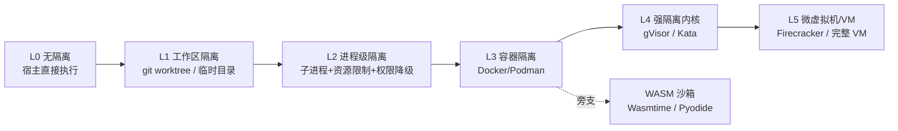

# 深入专题 · 沙盒与执行隔离（技术方案 + 对比选型）

> 为什么单独成篇：Agent 能跑代码就有了"手"，但**没有沙盒的 Agent 等于把 root shell 交给了一个会幻觉的程序**。这是 Harness 六层框架 L6（约束与恢复层）的核心实现。

## 1. 威胁模型：Agent 执行代码会出什么事

| 风险 | 具体表现 | 后果 |
|------|----------|------|
| 误删/误改 | `rm -rf` 路径写错、覆盖配置文件 | 数据不可逆丢失 |
| 越权访问 | 读取 `~/.ssh`、`.env`、云凭证 | 密钥泄露 → 账号被接管 |
| 数据外泄 | Agent 被提示注入后把敏感数据 POST 到外部 | 合规事故（且无法撤回） |
| 资源耗尽 | 死循环、fork 炸弹、内存泄漏 | 宿主被拖垮（雪崩） |
| 供应链风险 | 安装恶意依赖，执行 `postinstall` 脚本 | 后门植入 |
| 逃逸 | 容器配置不当导致逃逸到宿主 | 影响整个基础设施 |

**核心原则**：假设 Agent 一定会犯错或被注入——设计目标不是"让它不犯错"，而是**"犯错的爆炸半径可控"**。

## 2. 隔离等级光谱（从弱到强）



| 等级 | 隔离对象 | 冷启动 | 开销 | 逃逸风险 | 适用 |
|------|----------|--------|------|----------|------|
| L0 无隔离 | 无 | 0 | 0 | 极高 | ❌ 任何生产场景都不该用 |
| L1 工作区隔离 | 文件系统 | 极快 | 极低 | 高（进程仍裸奔） | 只读分析、纯文本编辑 |
| L2 进程级 | 进程/资源 | 毫秒 | 低 | 中 | 单机可信环境、个人开发 |
| L3 容器 | 内核命名空间+cgroups | 亚秒~秒 | 低~中 | 低（配置正确时） | **默认选择**（CI、团队环境） |
| L4 强隔离内核 | 系统调用层 | 亚秒 | 中 | 极低 | 多租户、执行不可信代码 |
| L5 微虚拟机 | 硬件虚拟化 | 毫秒级（Firecracker）~秒 | 中高 | 极低 | 云沙箱服务、多租户生产 |
| WASM | 字节码运行时 | 毫秒 | 低 | 极低（能力受限） | 纯计算、插件式扩展 |

> 选型口诀：**单机自用 L1~L2，团队 CI 用 L3，对外多租户必须 L4/L5**。

## 3. 主流技术方案详解

### 方案 A：Docker / Podman（最实用）
```bash
docker run --rm \
  --network none \                    # 默认断网（要网则走白名单代理）
  --read-only \                       # 根文件系统只读
  --tmpfs /tmp:size=512m \            # 只给临时可写区
  --memory 1g --cpus 1 --pids-limit 128 \
  --cap-drop ALL --security-opt no-new-privileges \
  -v "$PWD/work:/work:rw" \           # 只挂载工作目录
  -w /work python:3.12-slim \
  timeout 120 python script.py
```
- **优点**：生态成熟、镜像即环境、易与 CI 集成
- **缺点**：共享内核（逃逸风险存在）；冷启动亚秒到秒级
- **要点**：`--cap-drop ALL`、`no-new-privileges`、非 root 用户、只读根、PID 上限防 fork 炸弹

### 方案 B：gVisor / Kata Containers（强隔离内核）
- **gVisor**：在用户态实现系统调用接口（用户态内核），Agent 的 syscall 不直接进宿主内核 → 逃逸面大幅缩小
- **Kata**：每个容器配一个轻量 VM 内核，兼容 OCI 接口（对 Docker 命令透明）
- **代价**：系统调用密集场景性能下降（10%~数倍不等），兼容性偶有坑
- **选型**：多租户、执行外部用户代码、安全合规要求高时值得

### 方案 C：Firecracker 微虚拟机（云沙箱主流）
- AWS 出品，毫秒级启动的轻量 VM（Lambda/Fargate 底座）
- 每个沙箱一个独立内核 + 独立文件系统 → 隔离最强之一
- 代表产品：E2B、Daytona、Modal、Cloudflare Sandbox（各云厂商 Agent 沙箱）
- **用法**：不用自建，直接用托管沙箱 API（省掉最难的运维），本地开发可用其 SDK

### 方案 D：WASM 沙箱（Wasmtime / Pyodide）
- 编译为 WASM 后运行在能力受限的运行时：默认无文件/网络访问，需显式授权
- **优点**：毫秒启动、极低开销、跨平台、天然最小权限
- **缺点**：生态受限（不能随意跑任意 native 依赖与 shell 命令）
- **适用**：纯计算型工具（数据转换、公式计算、插件系统）——不给它 shell 是最好的保护

### 方案 E：进程级最小实现（Python 示例，无 Docker 时的底线方案）
```python
import subprocess, resource, os, tempfile

def run_sandboxed(code: str, timeout: int = 30):
    def limit():                       # 子进程资源限制（Linux）
        resource.setrlimit(resource.RLIMIT_CPU, (timeout, timeout))
        resource.setrlimit(resource.RLIMIT_AS, (512 * 1024**2, 512 * 1024**2))  # 512MB
        resource.setrlimit(resource.RLIMIT_NPROC, (64, 64))                     # 防 fork 炸弹
        resource.setrlimit(resource.RLIMIT_FSIZE, (10 * 1024**2, 10 * 1024**2))
        os.setsid()                     # 独立进程组，便于整组杀
    with tempfile.TemporaryDirectory() as workdir:
        proc = subprocess.run(
            ["python", "-c", code],
            cwd=workdir, env={"PATH": "/usr/bin", "HOME": workdir},  # 干净环境，不带宿主凭证
            preexec_fn=limit, capture_output=True, text=True, timeout=timeout,
        )
        return proc.stdout[:2000], proc.stderr[:2000]
```
- **优点**：零依赖、可嵌入任何程序
- **缺点**：**不是安全沙盒**（无内核隔离），只防"手滑"，防不住恶意代码——仅作兜底

### 方案 F：Jupyter Kernel / 语言级隔离
- 独立 kernel 进程 + 变量空间隔离，适合"数据分析型" Code Interpreter
- 局限：文件系统通常不隔离（需配合 chroot/容器）

## 4. 六道防线（沙盒之外的配套）

| 防线 | 手段 | 说明 |
|------|------|------|
| ① 文件系统 | 只读根 + 只挂载工作目录 + overlayfs 快照 | 快照让"随便改，随时回滚"成立 |
| ② 网络 | 默认无网；需要则**域名白名单代理** | 直接给全网出网 = 数据外泄通道 |
| ③ 凭证 | 密钥不进沙箱；由代理层注入 | Agent 看到的永远是占位符 |
| ④ 命令策略 | 白名单优先；危险模式检测（`rm -rf /`、`curl\|sh`） | 黑名单永远列不全 |
| ⑤ 资源 | CPU/内存/磁盘/PID/墙钟上限 | 每个沙箱都有"预算"，超限即杀 |
| ⑥ 审批 | L2 不可逆动作人工审批 | 见 [人机交互与协作用例](./人机交互与协作用例.md) |

**注**：①~⑥ 全部属于 Harness 组件——沙盒不是一个 Docker 命令，而是一套系统能力。

## 5. 对比选型决策表

| 场景 | 推荐方案 | 理由 |
|------|----------|------|
| 个人本地开发 Agent | L1 worktree + L2 进程限制 | 零运维、体验快 |
| 团队 CI 中跑 AI 生成的代码 | L3 容器（script 固定化） | 可复现、易集成 |
| 企业内部 Agent 平台（多部门） | L3/L4 容器 + 强隔离内核 | 部门间互不信任 |
| 对外的 Agent 产品（多租户） | **L5 托管云沙箱（E2B 等）** | 隔离最强、免运维、可弹性 |
| 纯计算工具（公式/转换） | WASM | 最小权限、毫秒启动 |
| 浏览器 Agent | 独立浏览器上下文 + 容器化 | 会话隔离 + 网络白名单 |
| 数据分析 Agent | 容器 + 只读数据挂载 + Jupyter | 便捷与隔离平衡 |
| 高合规行业（金融/医疗） | 私有部署 L4/L5 + 全审计 | 数据不出域、可追溯 |

**成本-隔离度权衡图（心智模型）**：
```
隔离强度：  无 < worktree < 进程 < 容器 < 强内核 < 微VM
运维成本：  0  <  极低   < 低   < 中   <   中高  < 高（或托管转嫁）
冷启动：    0  <  极快   < 毫秒 < 亚秒 <  亚秒  < 毫秒(Firecracker)/秒(VM)
```
> 结论：**先用容器，多租户再升级强隔离，能用托管云沙箱就别自建**（自建微虚拟机编排是专门的基础设施工程）。

## 6. 反模式（血的教训）

- ❌ 在宿主直接执行模型生成的代码（L0）——最常见也最致命
- ❌ 容器开着 `--privileged` 或挂载 docker.sock——等于没隔离
- ❌ 有网 + 有凭证 + 可写挂载 三者同时具备——数据外泄只差一次提示注入
- ❌ 只做黑名单命令过滤——`$(...)`、编码混淆、间接执行绕过方式无穷
- ❌ 沙箱内放云凭证"方便调试"——调试完忘记删是经典事故
- ❌ 无超时与资源上限——死循环 Agent 能把整台机器拖垮
- ❌ 沙箱快照有但没测过恢复——出事时才发现回滚脚本是坏的（定期演练）

## 7. 与其它专题的关系

- Harness 六层框架的 L6（约束/校验/恢复）→ [Harness工程实战](./Harness工程实战.md)
- 执行隔离是 10 个设计轴之一（execution isolation: none → worktree → sandbox → VM）→ [Agent工程体系总览](./Agent工程体系总览.md) §3
- 不可逆动作的人工审批 → [人机交互与协作用例](./人机交互与协作用例.md) §2.1
- 面试对应题 → [题库 09 Q40](../12-AI面试题库/09-Agent-MCP-Skills专项题库.md)、[题库 05 Q9](./README.md)
- 完整平台级落地（多租户/调度/合规）→ [云端智能体系统设计方案](./云端智能体系统设计方案.md)

## 8. 学完自测检查点

1. 说出隔离光谱六级，并指出"个人开发""团队 CI""对外多租户"各应选哪级
2. 容器方案必须加的三个安全参数是什么（cap-drop / no-new-privileges / 非 root）
3. 为什么"有网 + 有凭证 + 可写"是最危险的组合？举一个攻击链
4. 白名单与黑名单在命令过滤上的根本差异和结论
5. 六道防线分别属于"预防、限制还是恢复"？
6. 为什么"能用托管云沙箱就别自建"？自建的成本在哪

---

## 9. 企业级沙盒平台与框架清单（2026-10 联网核实）

> 以下按行业通行分类整理，信息均标注核实时间（2026-10），沙箱赛道以"月"为单位演进，使用前建议复核。

### 9.1 四大分类（行业通行框架）

| 类别 | 代表 | 定位 |
|------|------|------|
| 模型原生代码解释器 | OpenAI Code Interpreter、Gemini Code Execution | 模型自带执行能力，不可单独选用 |
| **通用远程 Devbox / Sandbox / VM** | E2B、Daytona、Modal、Runloop、Vercel、CodeSandbox、Together | 给 Agent "一台有边界的电脑" |
| **浏览器 / Computer Use 专用沙盒** | Browserbase、Hyperbrowser、Browser Use Cloud、AWS AgentCore Browser | 托管浏览器舰队，Live View/录制/人工接管是一等能力 |
| **开源自建运行层** | K8s Agent Sandbox、OpenSandbox、OpenHands Runtime、AIO Sandbox、Microsandbox | 私有化 / 合规 / 深度整合企业 K8s |

### 9.2 托管平台对比

| 平台 | 隔离技术 | 状态持久化 | 特色 | 适合 |
|------|----------|-----------|------|------|
| **E2B** | Firecracker microVM | **最完整**：文件系统+内存+进程 Pause/Resume | Desktop 模板（XFCE/noVNC）、模板快照 | 软件工程 Agent 默认首选 |
| **Daytona** | 容器/VM | 偏文件系统级归档 | SDK 暴露 process/fs/git/computerUse、Xvfb/VNC 录制 | 开源自托管路线 |
| **Modal** | 安全进程沙盒 | 文件系统快照 | Serverless GPU、CIDR 出网控制、号称 5 万+并发 | GPU 密集计算+沙箱一体 |
| **Runloop** | VM | 磁盘快照（进程需重启） | VM 保护 API Key/内网、Code Mounts、Tunnels | 企业内部工具 Agent |
| **Vercel Sandbox** | Firecracker | 快照恢复、默认 5min 自动停 | 与 Vercel AI 应用前后端一体化 | Vercel 生态用户 |
| **CodeSandbox SDK** | 自研 microVM | VM checkpoint/restore、快速 clone、休眠 | 前端/Web 预览场景 | Web 应用生成类产品 |
| **Cloudflare** | 边缘容器（V8 隔离/容器） | 会话级 | 沙箱推到离用户最近的边缘节点 | 低延迟全球分发 |
| **Blaxel** | MicroVM | 永续沙箱、待机零成本 | 声称待机恢复 <25ms、ZDR 合规 | 生产级 Agent 托管 |
| **Docker Sandboxes** | Firecracker | - | 每沙盒独立 Docker daemon+sudo、出网过滤代理 | Docker 生态用户 |

### 9.3 云厂商 Agent 沙箱组件

| 厂商 | 产品 | 隔离 | 说明 |
|------|------|------|------|
| AWS | **AgentCore Code Interpreter / Browser** | Firecracker 系 | 与 AgentCore 套件（Runtime/Memory/Gateway/Identity）一体，Browser 内建 Live View/录制/审计 |
| Azure | Dynamic Sessions（ACA Sessions） | **Hyper-V 虚拟化** | Azure Container Apps 会话池，Python 代码解释器 |
| 火山引擎 | AI 云原生沙箱服务 | microVM | 支持数万并发沙箱，配合豆包/方舟生态 |
| 腾讯云 | Agent Runtime | microVM | 底座级方案，Rust 系技术栈 |
| 阿里云 | OpenSandbox（开源）+ 百炼 | 可插拔（Docker/gVisor/Kata/Firecracker） | **最像平台级的开源沙盒**：多语言 SDK、K8s controller 资源池 |

### 9.4 开源 / 自建运行层

| 项目 | 定位 | 亮点 |
|------|------|------|
| **Kubernetes Agent Sandbox**（SIG Apps，2026-03） | 沙箱即 K8s 原生对象 | Sandbox CRD、WarmPool 预热池、暂停/恢复、可插拔隔离后端 |
| **OpenSandbox**（阿里开源） | 平台级开源沙盒 | 多语言 SDK、多 runtime 后端、资源池管理 |
| OpenHands Runtime | Agent 框架自带执行容器 | 适合框架内部安全执行层 |
| AIO Sandbox | 一体化（Browser+Shell+File+MCP+VSCode+Jupyter） | PoC 与评测环境 |
| Microsandbox / BoxLite | 自托管 microVM | 本地/私有服务器强隔离 |
| Anthropic sandbox-runtime | 开源预览 | 原生 OS 沙箱+代理网络过滤，最小安全边界参考实现 |

### 9.5 选型速查（场景 → 方案）

| 场景 | 推荐 |
|------|------|
| 软件工程 Agent（改码/跑测试/起服务） | E2B、Daytona、Modal、Vercel、Docker Sandboxes |
| Web Agent / Computer Use | Browserbase、Hyperbrowser、Browser Use Cloud、AgentCore Browser；要完整桌面看 Daytona/E2B Desktop |
| 企业私有化 / 合规 / K8s 深度整合 | OpenSandbox、K8s Agent Sandbox、OpenHands Runtime |
| 最在乎状态持久化 | E2B（文件+内存+进程完整恢复） |
| 最在乎强隔离 | AgentCore、Azure Dynamic Sessions、E2B、Vercel、Docker Sandboxes |
| 最在乎观测与人工接管 | Browserbase、Hyperbrowser、AgentCore Browser、Daytona |
| 国内合规/生态 | 火山引擎沙箱、腾讯云 Agent Runtime、阿里 OpenSandbox/百炼 |

### 9.6 冷启动优化技术（各家军备竞赛的核心）

- **预热池**（Warm Pool）：Google Agent Sandbox 用 Pod 预热实现亚秒级（比冷启动快 90%）
- **模板快照**：E2B 用 Dockerfile 预构建快照；Fly.io 用 COW 快照恢复 <1s
- **藏延迟**：OpenAI 把容器冷启动藏在 LLM 推理延迟之后
- **暂停/恢复**：E2B/Blaxel 的 Pause/Resume 让"待机零成本 + 恢复毫秒级"兼得

### 9.7 行业判断（一句话）

> Agent 沙盒正从"模型附带一个代码解释器"演进为"给智能体一台**有边界、有状态、可观察、可恢复**的电脑"。决定产品上限的五件事：**隔离边界、状态模型、执行面覆盖、网络与凭据治理、集成接入能力**。

### 9.8 来源（2026-10 核实）

- [Agent 沙盒的对比和分析 · CSDN](https://blog.csdn.net/monsion/article/details/159917672)
- [Agent Sandbox 选型：冷启动、计费与网络策略 · CSDN](https://blog.csdn.net/weixin_28568819/article/details/164177503)
- [AI Agent 沙箱技术选型与原理 · LangChain 中文社区](https://www.langchain.cn/t/topic/845/1)
- [AWS AgentCore Code Interpreter 官方文档](https://docs.aws.amazon.com/bedrock-agentcore/latest/devguide/code-interpreter-tool.html)
- [火山引擎 AI 云原生沙箱服务](https://www.volcengine.com/solutions/ai-cloud-native-sandbox)
